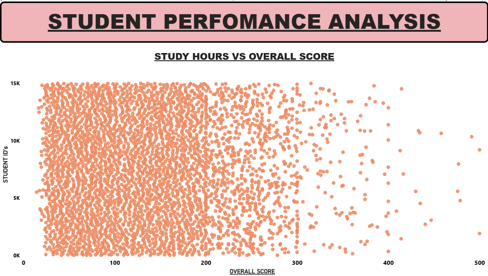
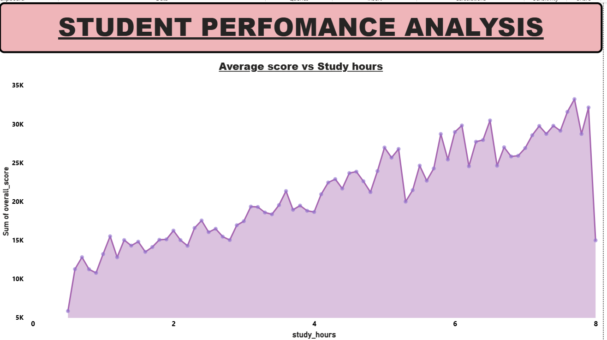
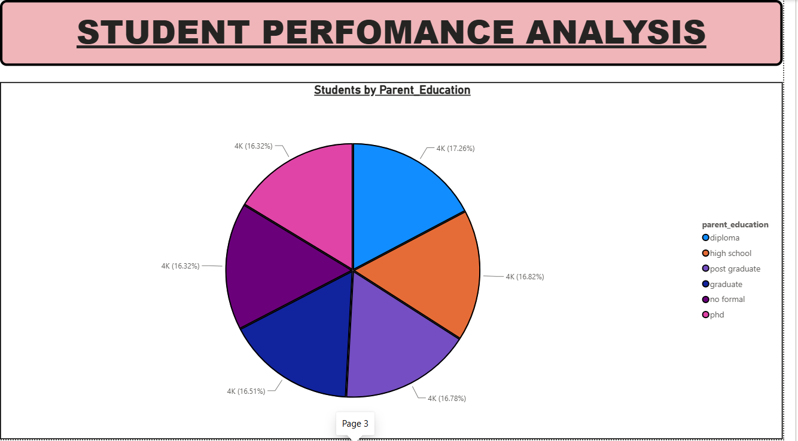
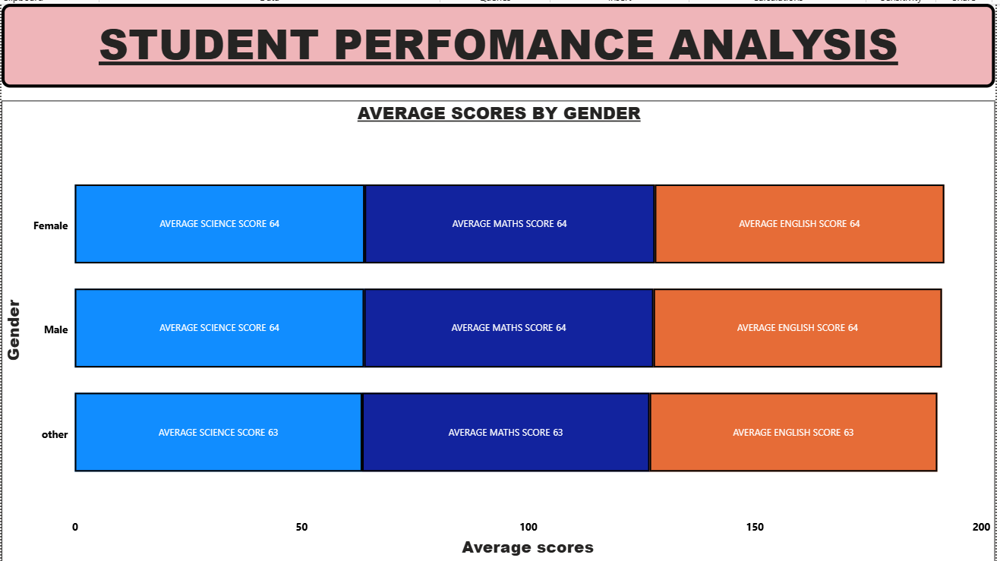
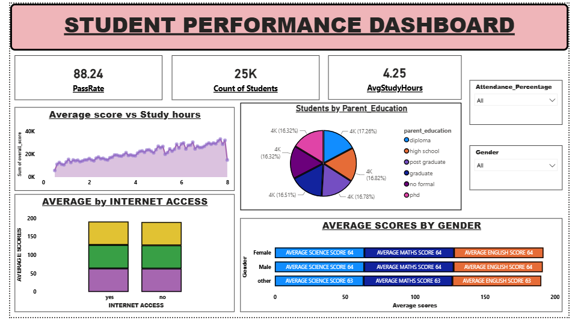

# week6-git-task
This repository contains my Week 6 internship task at InternNova, focused on learning Git &amp; GitHub basics. It includes the setup process, initial commits, and project files to demonstrate version control fundamentals. 

# Student Performance Analysis – Power BI Dashboard

## 📌 Project Overview
This project, Student Performance Analysis – Power BI Dashboard, focuses on understanding the academic outcomes of students by analyzing multiple factors such as study hours, attendance, parental education, and internet access. The goal is to uncover meaningful patterns that can help educators and institutions make data‑driven decisions to improve student success. Using a dataset of student records, the project applies data cleaning, exploratory data analysis, and visualization techniques to highlight correlations and trends. Tools like Python and Power BI were used to prepare the data, generate insights, and build an interactive dashboard that presents findings in a clear and actionable format. The outcome is a professional repository and dashboard that not only demonstrates Git workflow practice but also provides valuable recommendations for improving educational outcomes.

## 🎯 Problem Statement
Educational institutions often face challenges in identifying the key factors that influence student performance. With large amounts of data available, it becomes difficult to pinpoint which variables — such as study hours, attendance, parental education, or internet access — have the most significant impact on academic success. Without proper analysis, valuable insights remain hidden, and educators may struggle to design effective strategies that improve learning outcomes. This project addresses the problem by applying data cleaning, exploratory analysis, and visualization techniques to uncover meaningful patterns in student performance data. The goal is to provide actionable insights and recommendations through an interactive Power BI dashboard, enabling data‑driven decision‑making in education.

## 📊 Dataset Description
The dataset used in this project contains detailed records of student performance, covering multiple academic and demographic variables. It includes attributes such as study hours per week, subject scores, gender, parental education level, internet access availability, and attendance percentage. These features provide a comprehensive view of the factors that may influence student success. The dataset is structured in tabular format, with each row representing an individual student and each column representing a specific attribute. By analyzing these variables, the project aims to uncover correlations and patterns that highlight how different factors contribute to academic outcomes. This dataset serves as the foundation for data cleaning, exploratory analysis, and visualization, ultimately supporting the development of an interactive Power BI dashboard.

## 🛠 Tools Used
Power BI, Python (Pandas, NumPy, Matplotlib, Seaborn), SQL, GitHub.

## 🧹 Data Cleaning Process
  
The dataset was carefully inspected to ensure accuracy and consistency before analysis. Missing values were identified and handled appropriately, either by removal or imputation depending on the context. Duplicate records were checked and eliminated to avoid redundancy. Incorrect data types were corrected, such as ensuring numerical fields like study hours and scores were stored as numbers, while categorical fields like gender and parental education were standardized. Column names were renamed for clarity, and unnecessary attributes were removed to keep the dataset concise. Transformations such as normalizing attendance percentages and standardizing study hours were applied to improve reliability. This cleaning process ensured that the dataset was structured, consistent, and ready for exploratory data analysis and visualization.

## 🔍 Exploratory Data Analysis (EDA)
The EDA process was carried out to uncover meaningful patterns and relationships within the dataset. Descriptive statistics were used to summarize key variables such as study hours, attendance, and subject scores. Visualizations helped identify distributions and highlight trends, including how study hours correlated with higher performance and how attendance percentages impacted overall grades. Comparative analysis was performed across categories like gender, parental education, and internet access to observe differences in student outcomes. Correlation analysis revealed strong positive relationships between study hours and scores, while attendance also showed a significant influence. Outliers, such as students with extremely high study hours but low scores, were identified and examined to understand anomalies. This stage provided the foundation for deeper insights and guided the design of the Power BI dashboard, ensuring that the most relevant factors were highlighted for decision‑making.

## 📈 Visualizations

The following screenshots highlight key aspects of student performance:

- **Scatter Plot – Study Hours vs Scores**  
  

- **Line Graph – Performance Trends**  
  

- **Pie Chart – Parental Education Distribution**  
  

- **Bar Chart – Gender vs Average Scores**  
  

## 📊 Power BI Dashboard

The Power BI dashboard serves as the central visualization tool for this project, bringing together all the cleaned and analyzed data into an interactive format. It includes multiple charts and KPI cards that provide a comprehensive view of student performance. Scatter plots highlight the relationship between study hours and subject scores, while bar charts compare performance across gender and internet access categories. Pie charts illustrate parental education distribution, and line graphs track performance trends. KPI cards summarize key metrics such as average study hours, attendance percentage, and overall pass rate. The dashboard also incorporates slicers and filters, allowing users to interact with the data by selecting specific categories or ranges. This interactive design enables educators and stakeholders to explore insights dynamically, identify patterns, and make informed decisions based on real‑time analysis.
## 💡 Key Insights
Study Hours and Scores – Students who dedicate more study hours consistently achieve higher average scores across subjects, showing a strong positive correlation.

Attendance Impact – Higher attendance percentages directly contribute to better performance, highlighting the importance of consistent classroom participation.

Parental Education Influence – Students with parents holding higher education levels tend to perform better, suggesting a link between family background and academic outcomes.

Internet Access Advantage – Availability of internet access provides students with a slight edge in performance, likely due to access to digital learning resources.
